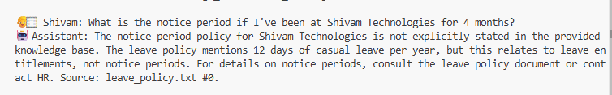
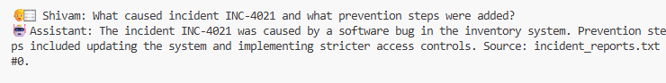
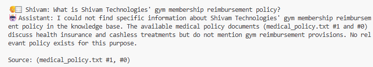

# Enterprise Knowledge-Base AI Assistant (RAG + Tool Calling)

A streaming CLI AI assistant for **Shivam Technologies** built from scratch in Python using an OpenAI-compatible Chat & Embeddings API, NumPy cosine-similarity retrieval, and multi-step function calling.

## Key Features

- **Custom RAG Pipeline (`rag.py`)**: Loads company `.txt` documents from `knowledge_base/`, splits them into section-based chunks (`\n\n`), generates vector embeddings, caches them in `vector_store.json`, and performs NumPy cosine-similarity search.
- **Streaming + Chained Tool Calling (`simple_ai_assistant.py`)**: Streams assistant text chunks and incremental tool-call payloads in real time across up to `MAX_STEPS = 5` chained reasoning rounds.
- **Modular Tool Suite (`tools.py`)**:
  - `search_knowledge_base` — semantic search across internal HR, leave, medical, hiring, engineering, RCA, and travel expense documents.
  - `get_current_time` — current local date and time.
  - `get_city_weather` — live weather lookup via `wttr.in`.
  - `get_user_city` — user city lookup for location-aware queries.
- **Grounded Prompting & Citations**: Instructs the assistant to answer company questions strictly from retrieved chunks, include inline citations (e.g., `(leave_policy.txt #3)`), and refuse out-of-scope company questions.

## Project Structure

```text
.
├── simple_ai_assistant.py   # Streaming CLI chat loop & chained tool-calling engine
├── rag.py                   # Document loader, chunking, embeddings, JSON vector store & search
├── tools.py                 # Tool schemas & runtime dispatcher
├── Utilities/
│   └── utilities.py         # Debug logger (enabled when DEBUG=True)
├── knowledge_base/          # Internal company policy & engineering .txt docs
├── code_snippets/           # Standalone experiments (chunking, streaming, ChromaDB)
├── docs/screenshots/        # CLI demo screenshots
├── requirements.txt
└── .env.example
```

## Setup & Usage

1. **Create and activate a virtual environment**
   ```bash
   python -m venv .venv
   # Windows PowerShell
   .\.venv\Scripts\Activate.ps1
   ```

2. **Install dependencies**
   ```bash
   pip install -r requirements.txt
   ```

3. **Configure environment variables**
   Copy `.env.example` to `.env` and fill in your OpenAI-compatible endpoint, model names, and paths:
   ```bash
   cp .env.example .env
   ```

4. **Run the assistant**
   ```bash
   python simple_ai_assistant.py
   ```
   On the first run (when `VECTOR_STORE_FILE` does not exist yet), `rag.py` chunks all `.txt` files in `KB_FOLDER`, generates embeddings, and saves them to `VECTOR_STORE_FILE`.

## Demo Screenshots

### 1. Policy Query


### 2. Incident RCA Query


### 3. Out-of-Scope Guardrail

